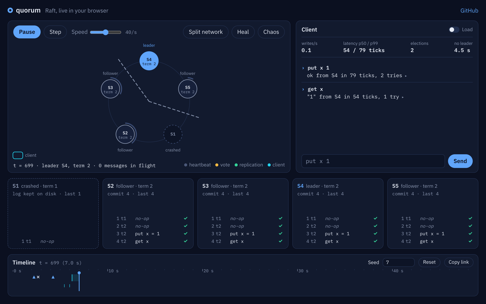

# quorum

A Raft-based replicated key-value store in C++20, tested with deterministic simulation.

> **Status:** step 7a of the roadmap: a replicated key-value store (put, get, delete, cas)
> with exactly-once client requests, on Raft (§5.2–5.4, §8), on a deterministic simulated
> network. Every fuzzed client history is checked for linearizability. Raft state is kept
> in checksummed files and recovered after crashes, and is tested on a simulated disk that
> loses or tears unsynced writes. There is no log compaction yet (§7), so the log grows
> without bound. A browser visualizer runs the same engine in WebAssembly.

**Try it:** [pranaviguttikonda.github.io/quorum](https://pranaviguttikonda.github.io/quorum/) runs the real
engine in your browser, compiled to WebAssembly. Crash servers, split the network and send
commands while you watch elections, replication and commits happen. Drag the timeline back
to any earlier moment, or press Chaos for a minute of random failures under load, followed
by a linearizability check of everything the clients saw.



## Why deterministic simulation

Bugs in distributed systems usually show up only under rare orderings of delays, message
losses, partitions and crashes. In quorum, every source of nondeterminism (time,
randomness, the network) goes through a single seeded simulator. A failing run can then be
replayed exactly from its seed, and thousands of adversarial schedules can run in seconds.

## Building and testing

Requirements: CMake ≥ 3.20 and a C++20 compiler (GCC or Clang).

```sh
cmake -S . -B build
cmake --build build --parallel
ctest --test-dir build --output-on-failure
```

To run only some tests, pass a substring of their names:

```sh
./build/tests/quorum_tests network_partition
./build/tests/quorum_tests replication_fuzz
./build/tests/quorum_tests kv_
```

The fuzz tests run 1,000 seeds each with random crashes, partitions, 10% message loss and
10% duplicate delivery while clients keep writing. Invariant checkers run after every tick:
Election Safety, Log Matching, State Machine Safety and Leader Completeness. The KV fuzz
also checks every client history for linearizability, with a Wing & Gong/Porcupine-style
checker that explains any failure. It checks that every replica ends up with the same map,
and that every write executed exactly once. Every fuzz suite also runs with nodes on
file-backed storage over a simulated disk, where each crash is a power loss that drops or
tears unsynced writes, and some crashes land in the middle of a disk call. A failure prints
its seed, and the same seed replays the same run exactly.

Each fuzz test runs `QUORUM_FUZZ_SEEDS` seeds (default 1000), for example
`QUORUM_FUZZ_SEEDS=200 ./build/tests/quorum_tests`. CI uses 200 in Debug and 1000 in Release.

The code builds with `-Wall -Wextra -Werror`. CI runs on Ubuntu and macOS in Debug and
Release.

## Visualizer

The page in `web/` is plain HTML, CSS and JavaScript. It draws what the engine reports and
nothing else. It has a dark "control room" theme, and a cool light one when the system asks
for light. Every colour is a CSS variable, including the ones the canvases use, and text
meets WCAG AA in both schemes. The fonts are IBM Plex Sans and IBM Plex Mono (self-hosted
Latin-1 subsets, 78 KB in all). `web::Simulation` (`include/quorum/web/simulation.h`) hosts a 5-server
`KvCluster` with memory storage. It is exposed to the page through embind and returns
JSON snapshots. Building the page needs Emscripten:

```sh
emcmake cmake -S . -B build-web -DCMAKE_BUILD_TYPE=Release
cmake --build build-web --target quorum_web    # writes build-web/site
python3 -m http.server -d build-web/site 8000  # then open http://localhost:8000
```

A run's seed and every action you take are kept in the URL, so "Copy link" replays the run
exactly. The same recording drives the timeline: scrubbing back rebuilds the engine from the
seed and replays the actions up to that tick, and a new action from there starts a new
branch. The load generator and chaos mode run inside the engine on seeded streams, so they
replay too. When chaos ends, the page runs the same linearizability checker as the fuzz tests
on the whole client history. CI checks that the WebAssembly build prints the same scenario trace as the native
build, then uses the page in headless Chrome (`scripts/web_smoke.mjs`). Pushes to `main`
deploy it to GitHub Pages.

## Layout

```
include/quorum/sim/     deterministic RNG, tick clock, simulated network, simulated disk
include/quorum/storage/ file interface, POSIX files, CRC32
include/quorum/codec/   strict text codec shared by every wire format
include/quorum/raft/    Raft node, messages, storage (memory, files), services, test cluster, invariant checkers
include/quorum/kv/      KV state machine, server, simulated client, history, KV cluster
include/quorum/web/     host for the browser visualizer (JSON snapshots)
web/                    the visualizer page and its embind bindings
scripts/                WASM determinism check and headless-browser smoke test
src/                    implementation
tests/                  test harness and tests
docs/                   design notes
```

## Roadmap

See [docs/VISION.md](docs/VISION.md).
